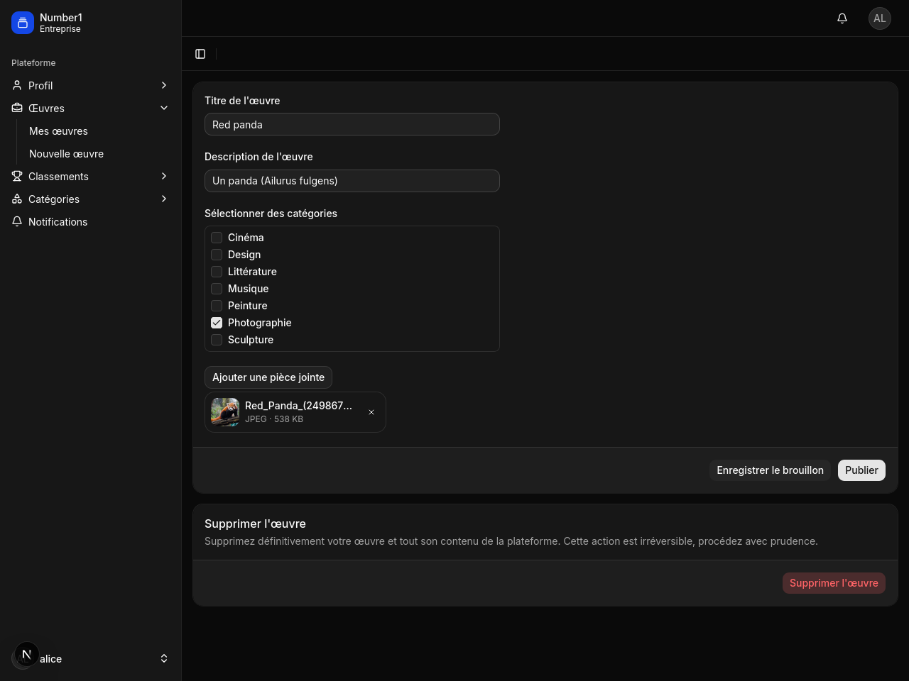
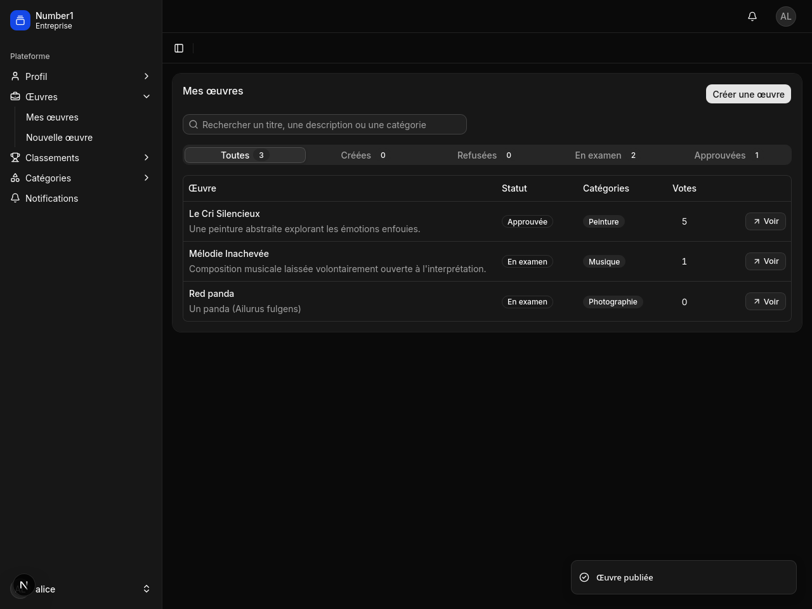
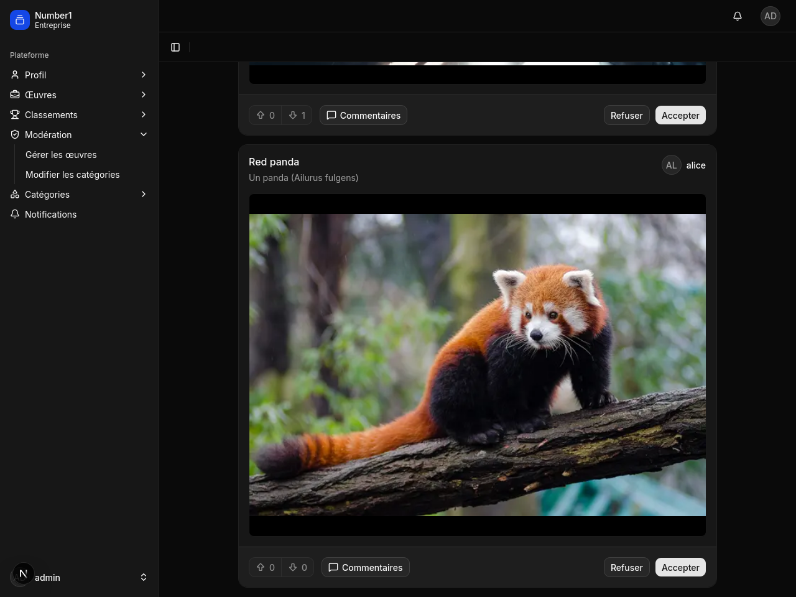
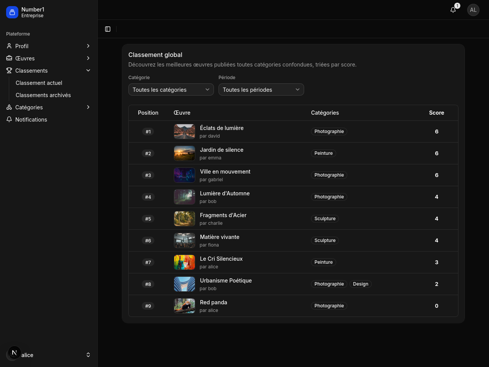
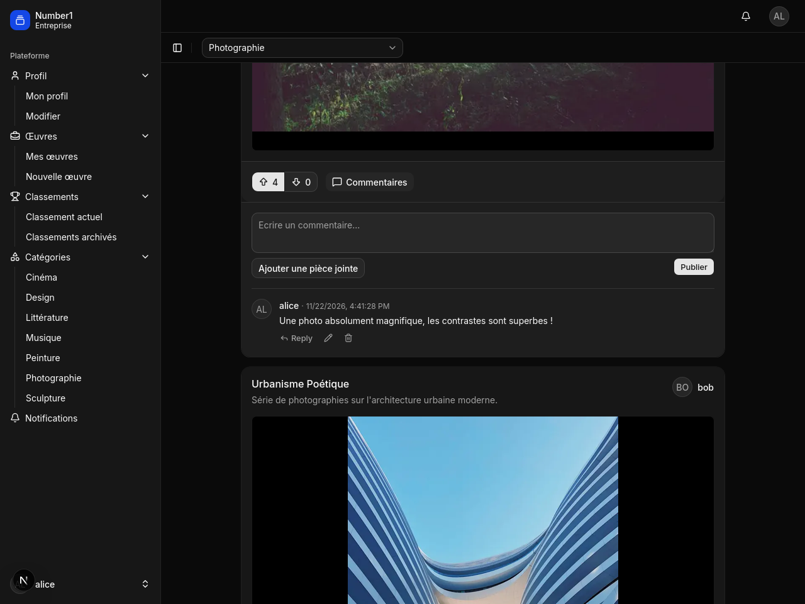
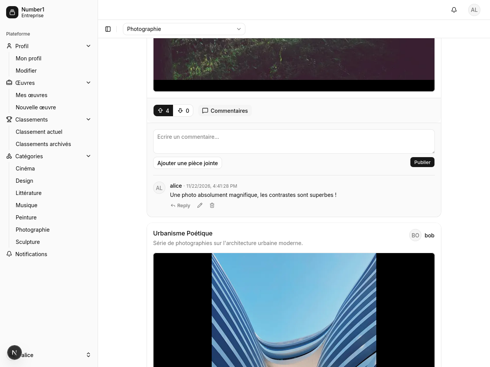
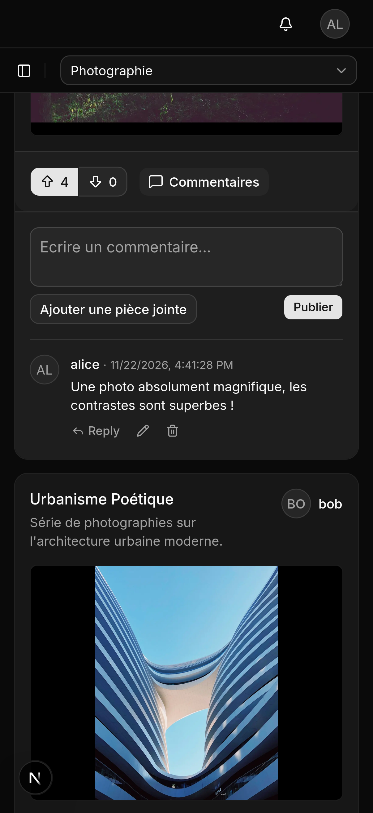
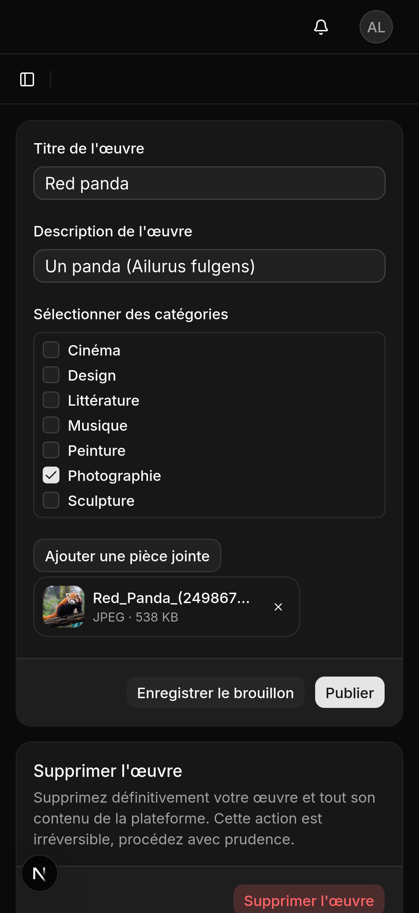
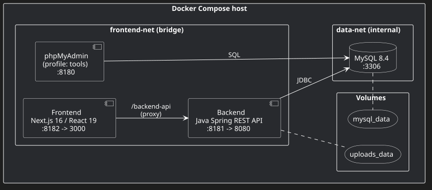

# Number1

A community ranking app where people submit works, comment on them, and vote. The site automatically publishes a **top works per category** for the **week, month and year**.

Built with a **Next.js** frontend and a **Spring Boot** REST backend, coordinated through an **OpenAPI** contract, and covered by unit and BDD acceptance tests on both sides.

> Originally developed as a Master 2 ISL project (Université Marie et Louis Pasteur): one team wrote the specifications and Gherkin acceptance tests in Squash TM, another team (this repository) implemented them.

## Features

| Role                   | Capabilities                                                                                                                             |
| ---------------------- | ---------------------------------------------------------------------------------------------------------------------------------------- |
| **Visitor**            | Browse works, categories and rankings, view user profiles, register / login in                                                           |
| **Authenticated user** | Submit works, edit / delete their own works, comment and reply, edit or delete their own comments, vote on any work **except their own** |
| **Administrator**      | Approve or reject submitted works, add or remove categories, delete comments                                                             |

**Rankings:** a scheduler periodically computes and archives the most-voted works of each category for the current week, month and year.

## Screenshots

> The interface is in French and supports light and dark themes.

|                Add new work                |                  User works                  |
| :----------------------------------------: | :------------------------------------------: |
|  |  |

|                   Admin moderation                   |                    Rankings                     |
| :--------------------------------------------------: | :---------------------------------------------: |
|  |  |

|                               Category feed                               |                         Category feed light                          |
| :-----------------------------------------------------------------------: | :------------------------------------------------------------------: |
|  |  |

|                      Category feed Mobile version                       |                     Add new work Mobile version                      |
| :---------------------------------------------------------------------: | :------------------------------------------------------------------: |
|  |  |

## Tech stack

**Backend**

- Java 26, Spring Boot 4.1 (Web MVC, Data JPA, Security, Validation, Mail)
- MySQL 8.4, schema managed by Flyway
- Tests: JUnit, MockMvc, Mockito, Cucumber, H2

**Frontend**

- Next.js 16, React 19, TypeScript
- Tailwind CSS 4, shadcn/ui, Base UI
- Tests: Jest + React Testing Library, Playwright + playwright-bdd (Gherkin)

**Infrastructure**

- Docker & Docker Compose, GitLab CI/CD

## Architecture



- The browser only talks to the **frontend**. Requests to `/backend-api/*` are proxied by Next.js to the backend.
- The **database** sits on an internal-only Docker network (`data-net`) and is not reachable from outside.
- Uploaded images and database files live in named Docker volumes.
- Health checks are chained: backend waits for the database, frontend waits for the backend.

## Getting started

### Prerequisites

- Docker and Docker Compose v2 (to run everything in containers)
- For local development without Docker: Java 26, Maven 3.9+, Node.js 22, MySQL 8.4

### Run with Docker Compose

```bash
git clone https://github.com/massylamarni/community-ranking-platform
cd community-ranking-platform

# Create the backend environment file
cp backend/.env.example backend/.env

cd infrastructure/docker && docker compose up -d --build
```

| Service     | URL                   |
| ----------- | --------------------- |
| Frontend    | http://localhost:8182 |
| Backend API | http://localhost:8181 |
| phpMyAdmin  | http://localhost:8180 |

phpMyAdmin is behind the `tools` profile and bound to localhost only:

````bash
docker compose --profile tools up -d

### Run locally for development

**Backend**

```bash
cd backend
# needs a MySQL database named numero_number_one, see Configuration
./mvnw spring-boot:run
````

**Frontend**

```bash
cd frontend
npm ci
npm run dev        # http://localhost:3000
```

**For a hybrid run**

```bash
# Run with Docker Compose
cd frontend
BACKEND_URL=http://127.0.0.1:8181 INTERNAL_API_URL=http://127.0.0.1:8181 NEXT_PUBLIC_API_BASE_URL=/backend-api npm run dev -- --hostname 127.0.0.1 --port 3100

```

## Configuration

### Docker Compose variables

| Variable              | Default | Description                                                      |
| --------------------- | ------- | ---------------------------------------------------------------- |
| `MYSQL_ROOT_PASSWORD` | `root`  | MySQL root password. **Change it outside of local development.** |

### Backend

The backend reads `backend/.env` (loaded by Compose) and these variables set by the Compose file:

| Variable                      | Description                                |
| ----------------------------- | ------------------------------------------ |
| `DB_URL`                      | JDBC URL of the MySQL database             |
| `DB_USERNAME` / `DB_PASSWORD` | Database credentials                       |
| `UPLOAD_DIR`                  | Directory where uploaded images are stored |

Add any other secrets (e.g. SMTP settings for the mail starter) to `backend/.env`.

### Frontend

| Variable                           | Description                                                    |
| ---------------------------------- | -------------------------------------------------------------- |
| `NEXT_PUBLIC_API_BASE_URL`         | Base path used by the browser to call the API (`/backend-api`) |
| `INTERNAL_API_URL` / `BACKEND_URL` | Backend URL used server-side by the Next.js proxy              |
| `NEXT_PUBLIC_API_MOCKING`          | `enabled` to use MSW mocks, `disabled` to use the real API     |

## Testing

Acceptance scenarios are written in Gherkin and derived from the specification. The `.feature` files live in `tests/acceptance/` and are shared with the backend test classpath.

```bash
# Backend: unit + Cucumber acceptance tests
cd backend && ./mvnw test

# Frontend: unit tests
cd frontend && npm run test:unit

# Frontend: end-to-end acceptance tests (requires the stack to be running)
cd frontend && npx playwright install chromium
cd frontend && npm run test:e2e
```

## API documentation

The REST API is described by an OpenAPI contract, See .

## CI/CD

GitLab CI/CD runs the backend unit tests and acceptance tests on every push and merge request, and deploys over SSH when changes land on `main`.
